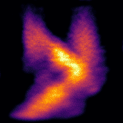
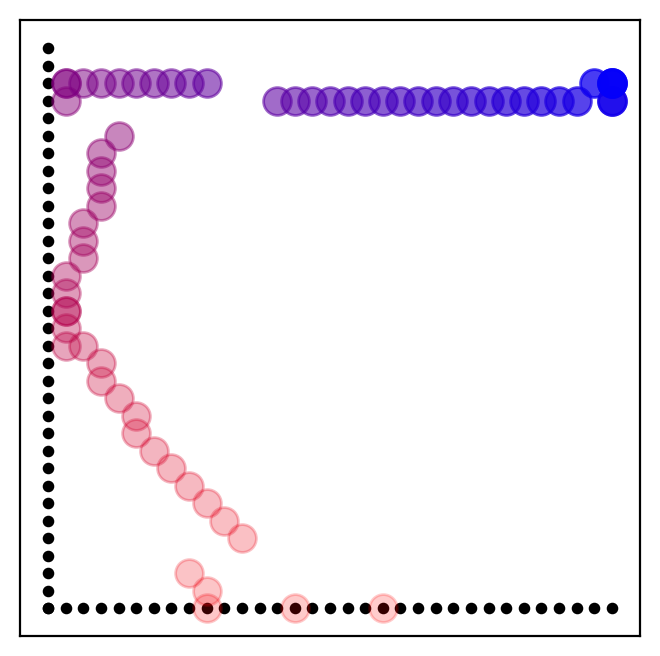
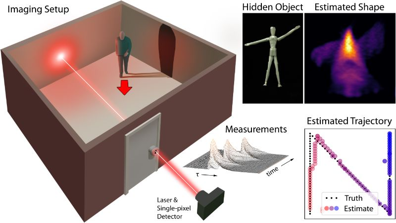

# ApertureTrace

Hidden-object reconstruction from time-resolved light along one optical path. A CPU-ready continuation of the [Keyhole Imaging research implementation](#source-and-license), with analytical checks and retained run evidence.

## One capture, two estimates

**The run completed; its raw motion criterion failed.** Unaltered exports from one full K-scene CPU run: object reconstruction, then raw trajectory.

<p>
  
  
</p>

In the trajectory, black points show the source-labeled reference and colored points show estimates. Raw root mean square position error was **0.768 m**, versus **0.330 m** for a constant-position estimate. These images establish successful export, not image quality or physical accuracy. [Full run record and reflection diagnostic](VERIFICATION.md#complete-k-reconstruction-2026-10-01).

## How it works

The solver alternates between estimating where the object was and refining its shape. A Lambertian light-transport model predicts arrival-time measurements for candidate positions; those predictions are compared with the capture over 30 optimization stages. ApertureTrace preserves the research method and adds CPU guidance, kernel checks, and verification records.

## Run on CPU

The modern CPU check uses Python 3.12 on macOS arm64. Create an isolated environment and install the tested direct dependencies:

```sh
python3.12 -m venv .venv
.venv/bin/python -m pip install -r requirements-cpu.txt
```

Run from the repository root. `K` is the smallest included capture, with 66 measurement rows. This command uses the original 256 × 256 grid and all 30 optimization stages, limits PyTorch to two CPU threads and saves figures without opening windows:

```sh
MPLBACKEND=Agg .venv/bin/python - <<'PY'
import runpy
import sys
import torch

torch.set_num_threads(2)
torch.set_num_interop_threads(1)
sys.argv = ["Demo.py", "--reconstruction", "K"]
runpy.run_path("Demo.py", run_name="__main__")
PY
```

Choose `E`, `K`, `Y`, `Mannequin` or `Mannequin_Assymetric`. The source default remains `Mannequin_Assymetric`. Outputs are written to `reconstructions/`; use `.venv/bin/python Demo.py --help` for the original arguments. A run can consume several GiB of memory. Thread settings limit CPU concurrency, not memory use or elapsed time.

## Compute and data

Captured `.mat` data for all five scenes is included. CPU execution is the default. The original `KeyholeEnvironment.yml` is preserved for the historical Conda stack; it pins old Python, PyTorch and CUDA versions and was not recreated by the modern CPU check. CUDA remains disabled in the source.

Radiometric formulas, regularizers, learning rate, iteration schedule, coordinate conventions, file names, and the scientific figure remain unchanged. The sampler utilities rebuild implicit grids for each call, accept their NumPy defaults, and support the optional three-bin filter.

## Verification

The complete default-resolution K run finished in 503 seconds with finite numerical values and valid array/image exports. Its raw trajectory error failed the declared constant-position baseline. [Verification](VERIFICATION.md) records that failure, the separate reflection diagnostic and the limits on image quality, convergence and physical accuracy. Initialization remains random; this single run is not a repeatability guarantee.

## Original research overview



This overview belongs to the original research project. It is separate from the retained CPU run above.

## Source and license

Derived from [KeyholeImaging](https://github.com/computational-imaging/KeyholeImaging/tree/10d9f12f362d912793159c9dfc3d021d7137d5fe) under [BSD-3-Clause](LICENSE). [NOTICE.md](NOTICE.md) records the research source and ApertureTrace additions.
